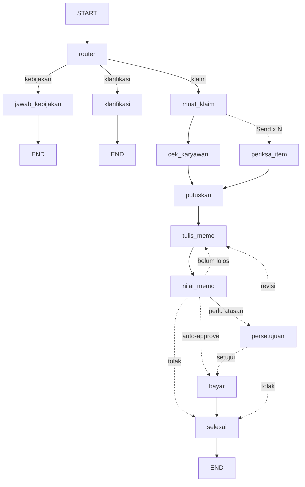

# langgraph-klaim-lab

Lab belajar **LangGraph dari nol**, satu proyek utuh: agent **klaim reimbursement karyawan**.

Versi sederhana dari `ggf-qc-agent` (domainnya jauh lebih mudah), tapi keluasan materi LangGraph-nya sama: router dengan structured output, fan-out paralel dan join, map-reduce dengan `Send`, evaluator-optimizer, human-in-the-loop (`interrupt`), checkpoint SQLite dan resume lintas proses, `RetryPolicy`, efek samping idempoten, guardrail prompt injection, streaming, **LangGraph Studio**, dan pola orkestrasi supervisor / handoff / planner-executor.

👉 **Mulai dari [`LAB.md`](LAB.md).** Isinya 14 tahap (0–13), masing-masing dengan spesifikasi, test, eksperimen, dan petunjuk.

## Isi folder

```
langgraph-klaim-lab/
├── LAB.md               # panduan lab tahap demi tahap  ← mulai di sini
├── app/                 # KAMU yang menulis isinya (Tahap 0: buat foldernya)
├── tests/               # spesifikasi per tahap: test_tahap01_tools.py ... test_tahap12_pola.py
├── data/
│   ├── klaim.json       # 5 klaim latihan (KLM-001 ... KLM-005)
│   ├── karyawan.json    # profil + sisa anggaran (API HR tiruan)
│   ├── kebijakan.json   # aturan yang dipakai kode
│   └── kebijakan/*.md   # aturan versi teks (untuk RAG mini)
├── _kunci/              # kunci jawaban (app/ lengkap + langgraph.json). Jangan dibuka sebelum buntu.
├── .env.example         # konfigurasi; default LLM_MODE=mock (tanpa API key)
└── pyproject.toml, uv.lock
```

## Quick start

```bash
cd ~/Learning/langgraph-klaim-lab
uv sync
cp .env.example .env            # bila belum ada
KUNCI=1 uv run pytest -q        # kunci jawaban: 55 passed (environment sehat)
mkdir -p app && touch app/__init__.py
uv run pytest tests/test_tahap01_tools.py -q   # mulai Tahap 1: merah dulu, lalu buat hijau
```

Lihat sistem jadinya (versi kunci), sebelum mulai menulis:

```bash
cd _kunci
uv run python -m app.cli jalankan "Proses klaim KLM-001" --thread demo-1   # berhenti menunggu atasan
uv run python -m app.cli lanjut --thread demo-1 --aksi setujui              # proses baru, lanjut dari checkpoint
uv run langgraph dev                                                        # buka Studio di browser
```

## Alur graph akhir



## LLM

- Default **mock**: setiap pemanggilan LLM punya fallback deterministik. Gratis, cepat, cocok untuk test dan Studio.
- **Live** (Tahap 13): endpoint OpenAI-compatible apa pun, yaitu Sumopod, vLLM lokal (seperti di notebook Colab Pertemuan 5), atau Ollama. Atur di `.env`.

Semua data di `data/` sintetis.
